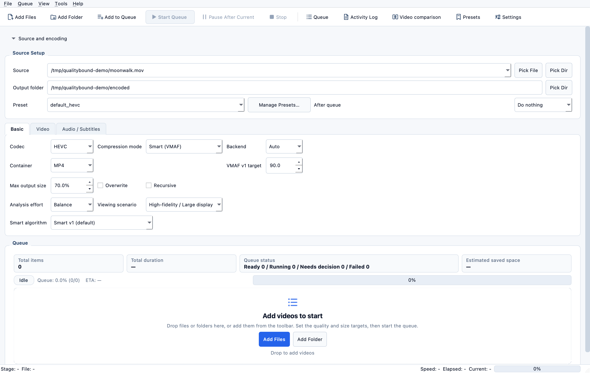

# QualityBound

**Perceptual video compression under explicit quality and size constraints.**

[](https://github.com/starfield17/QualityBound/actions/workflows/ci.yml)
[](https://github.com/starfield17/QualityBound/releases/latest)
[](LICENSE)

CRF is an encoder setting, not a perceptual-quality measurement, and a fixed
bitrate leaves quality unchecked. Specify the constraints directly instead:

```text
VMAF >= 90
output <= 50% of source
```

QualityBound samples the video, searches for a conforming AV1 or HEVC bitrate,
validates it on unseen holdout windows, and checks the completed encode before
publishing it.



## Download

[Download the latest release](https://github.com/starfield17/QualityBound/releases/latest)
for Windows x86-64/ARM64, Linux x86-64/ARM64, or macOS Apple Silicon. Tagged
packages bundle a compatible FFmpeg and FFprobe build (pre-rename releases
retain their original filenames).

- **macOS:** Releases are ad-hoc signed, not notarized; Gatekeeper may require
  right-click → **Open**.
- **Linux:** Requires a reasonably recent `glibc`.

## How it works

QualityBound is not a general-purpose FFmpeg wrapper, media editor, or format
converter. It deliberately restricts options to HEVC/AV1 presets and constraint
controls so every job runs through one verifiable pipeline:

1. **Scout:** Scans the timeline for spatial complexity (SI), temporal
   complexity (TI), and scene boundaries (short clips are analyzed whole).
2. **Window selection:** Combines difficult and time-stratified windows for
   search while keeping a disjoint, non-overlapping holdout set untouched.
3. **Candidate search:** Encodes trial windows with the bound encoder, scores
   them with Netflix VMAF, and predicts full-file size from measured sample
   bytes rather than requested bitrate.
4. **Holdout check:** Validates the chosen bitrate on the unseen holdout
   windows.
5. **Constraint promotion:** If any holdout fails, all failed holdouts become
   search constraints and the search resumes upward.
6. **Validated publication & size-miss gate:** Writes the full encode to a
   temporary file beside the target and checks its actual size before
   publishing. Oversized outputs are preserved as `*.size-miss-<id>.*` for
   explicit accept, retry, or delete — never silently published over the target.

- **Conflicts & skips:** Predicted quality/size conflicts follow your
  configured relaxation or ask policy; if the remaining conflict predicts a file
  larger than the source, the item is skipped and handled by the **Copy / Ask /
  Ignore** source-output policy.
- **Receipt cache:** Sample measurements persist as versioned receipts keyed
  by source, FFmpeg binary, bound encoder, measurement settings, and sample
  scheme (`workdir/analysis/receipts/`), so policy-only threshold changes reuse
  existing candidate scores.

See [Algorithm and constraint flow](docs/algorithm.md) for the scoring and
prediction details, and [Evaluation scope](docs/smart-evaluation.md) for what
current evidence does and does not establish.

## Quick start

Run from a source checkout:

```bash
python -m pip install -r requirements.txt
python main.py
```

- **GUI:** Add or drop files into the queue, set constraints and output
  directory, and click **Start Queue**. Batch settings bind on start (with
  per-row right-click overrides and **Needs decision** prompts when a rule
  fails). Supports English, 简体中文, and 日本語 via **Settings → Language** or
  `--lang`.
- **CLI & presets:** Built-in HEVC and AV1 presets default to Smart v1
  (`--min-vmaf 90`; `--max-output-ratio` `0.7` for HEVC, `0.5` for AV1). CLI
  exit codes: `0` success (including intentional skips), `2` failure or error,
  `3` decision required.

```bash
python main.py --gui --lang ja
python main.py --cli plan input.mp4 --lang ja
python main.py --cli encode input.mp4 --backend auto --overwrite
```

When compatible VMAF filters are unavailable, use fixed-bitrate mode
explicitly:

```bash
python main.py --cli encode input.mp4 --compression-mode fixed_bitrate --ratio 0.76
```

- **Backends:** Supports CPU, NVIDIA NVENC, Intel QSV, AMD AMF, and Apple
  VideoToolbox where FFmpeg and local hardware expose them (plus `auto`).
  QualityBound runs runtime encoder smoke tests rather than assuming support
  from encoder names alone.
- **Video comparison:** Open via **Video comparison** in the toolbar or
  right-click a finished row (**Compare source and output**). Provides
  side-by-side and single-view A/B toggling (`Tab` / `T`), synchronized
  playback (`Space`), `B offset` alignment, and paused frame-by-frame
  inspection decoded by the selected external FFmpeg/FFprobe pair (Qt displays
  images and outputs PCM audio only).
- **Smart v2 (experimental):** Opt in via **Smart v2 (experimental)** in the
  GUI or `--smart-algorithm v2_experimental`. Unlike Smart v1's single-bitrate
  sampled gate, v2 allocates bitrates per shot against a whole-video mean
  `--min-vmaf` target with per-shot quality floors, runs an encode/concat
  preflight, and scores the complete output. Requires CFR SDR media and takes
  noticeably longer; see [Smart v2](docs/smart-v2.md).

## Known limitations

- **MP4 output cannot carry bitmap subtitles.** MP4 subtitle streams use
  `mov_text`, which accepts text sources only. Sources containing PGS, VobSub,
  or DVB subtitle streams are refused during planning with the offending codec
  rather than failing after a full encode or silently dropping streams. Choose
  MKV to keep bitmap subtitles; see
  [Development, translations, and packaging](docs/development.md) (Known
  limitations).

## Documentation

- [Algorithm and constraint flow](docs/algorithm.md)
- [Smart v2 (experimental)](docs/smart-v2.md)
- [Architecture](docs/architecture.md)
- [Development, translations, and packaging](docs/development.md)
- [Evaluation scope and limitations](docs/smart-evaluation.md)
- [Synthetic Smart corpus](docs/smart-corpus.md)
- [CI and release workflows](docs/ci-workflows.md)
- [Release contract map](docs/release-map.md)

## License

QualityBound is released under the [MIT License](LICENSE). Bundled FFmpeg and
Netflix VMAF artifacts retain their own licenses and source/build provenance.
